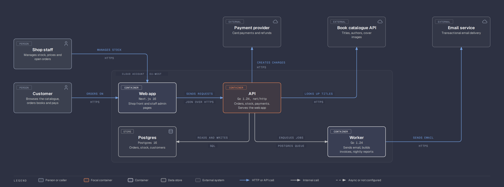

# c4-diagram

A Claude Code skill that draws [C4 model](https://c4model.com) diagrams of a software product from its code, in the [diagram-design](https://github.com/cathrynlavery/diagram-design) visual system.

It helps a developer see the system they build: who uses it, what each user type sends in and gets out, which containers run, how they talk, and where they run.

## What it does

Two steps:

1. **Discover.** The agent reads the repos (deploy specs, Dockerfiles, CI workflows, config, routes, outbound clients, queues, schemas) and writes `c4-model.json`. Every element carries a `source` (`repo/path:line`). A guess is marked `"inferred": true`.
2. **Draw.** `scripts/render_c4.py` renders three diagrams from the model: System Context, Container and Deployment. C4 gives the content: element types, technology, one-direction verb labels, title and legend. diagram-design gives the look: node boxes with type tags, orthogonal connectors, labels on masks, zones, a legend strip, light and dark skins. `scripts/c4_check.py` is the gate: the C4 review checklist, the geometry checks, and the diagram-design checkers `self_check.py` and `verify_geometry.py`.

Component and Code diagrams are out of scope on purpose. C4 says "the system context and container diagrams are sufficient for most software development teams."

## Example

`examples/bookshop/` holds a small model and its renders.


Dark variant of the container diagram (`--dark`):



## Install

Copy this folder to your skills directory:

```bash
git clone https://github.com/STBlackHawk/c4-diagram-skill ~/.claude/skills/c4-diagram
```

Claude Code lists it as `c4-diagram`. Ask for "a C4 diagram of this repo" or "what goes in and out of this system".

## Render by hand

```bash
cd examples/bookshop
python3 ../../scripts/render_c4.py c4-model.json --out diagrams --dark
python3 ../../scripts/c4_check.py c4-model.json diagrams
pip install playwright && playwright install chromium
python3 ../../scripts/export_png.py diagrams/c4-context.html diagrams/c4-context.png
```

The renderer and the checkers need Python 3.10 and nothing else. PNG export needs Playwright.

## Model file

See `references/model-schema.md`. The short version:

- `people[]`: human roles and machine callers, each with `inputs`, `outputs`, `main_in` and `main_out`.
- `external_systems[]`: things you do not own, with `in_label` and `out_label`.
- `containers[]`: applications and data stores with `technology`, placed on a grid with `layout: {gx, gy}`.
- `relationships[]`: one direction each, a verb label, a technology for container-to-container lines.
- `deployment.environments[]`: nodes and container instances per environment, with counts, sizes, artifacts and versions.

The model is the editable middle step. Fix a wrong fact or a bad layout in the model, never in the HTML.

## Brand profile

Colours and fonts come from a profile. `profiles/default.json` is the diagram-design skin, light and dark. Name a profile in a `.c4-diagram` or `.diagram-design` marker (`profile: <slug>`) next to the model, or pass `--profile <slug>`. The renderer then reads `profiles/<slug>.json` next to the model or in the skill, and a saved diagram-design profile `~/.diagram-design/profiles/<slug>.md` when one exists. A brand onboarded once in diagram-design works here with no second file. Keep a private brand next to the model, not in the skill.

## Rules the renderer keeps

From C4:

- Every element shows its name, type and description. Every container shows its technology.
- Every arrow is one direction with a verb label. Container and deployment arrows name a technology or protocol.
- Every diagram has a title that names the type and the scope, and a legend.
- At most 8 people and 8 external systems on the System Context diagram, with one arrow in and one out per element. The full inputs and outputs go into `c4-tables.md`.

From diagram-design:

- Orthogonal connectors only, with `r=8` elbows and fanned ports. `route: "vh"` flips an elbow that would pass behind a box.
- Every arrow label sits on a paper mask with a visible gap from its line and never under a later node.
- At most two accent elements per diagram.
- Everything on the 4px grid; names in sans, technology in mono, the title in serif; an accessible `<title>` and `<desc>` on every SVG.

## Credits

The visual system is [diagram-design](https://github.com/cathrynlavery/diagram-design) by Cathryn Lavery, MIT License. `scripts/self_check.py`, `verify_geometry.py`, `export_png.py` and `export_svg.py` are copied from it unchanged; see `scripts/LICENSE.diagram-design` and `scripts/VENDOR.md`. The node icons are [Tabler Icons](https://tabler.io/icons), MIT. C4 is by Simon Brown, [c4model.com](https://c4model.com).

## License

MIT. See `LICENSE`.
