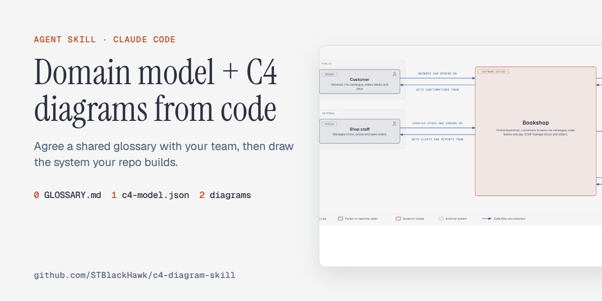
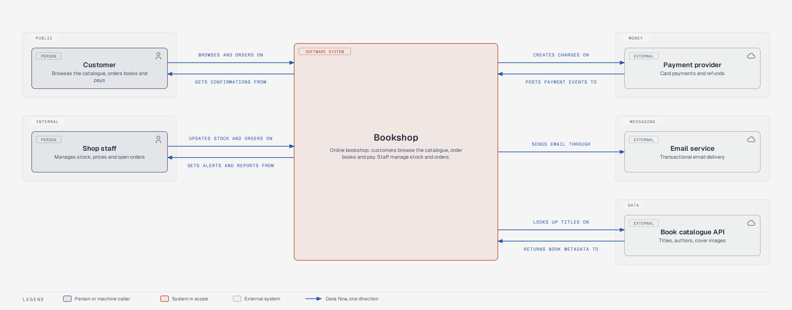
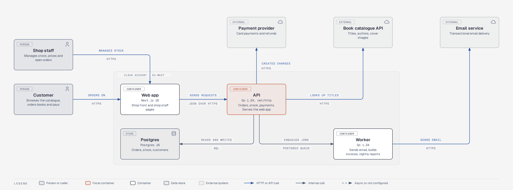
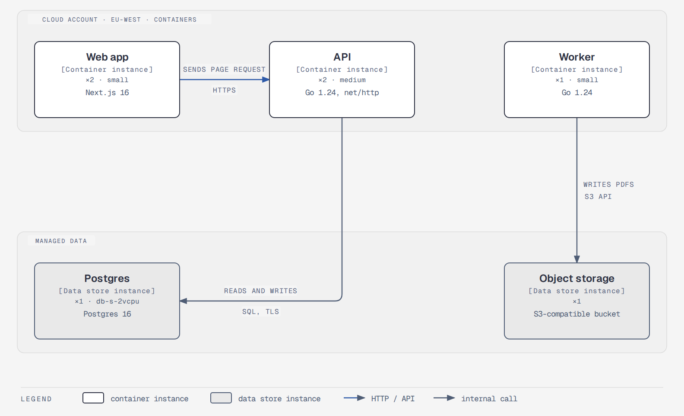

<p align="center"></p>

# c4-diagram: domain modeling and C4 architecture diagrams from code

[](LICENSE)
[](SKILL.md)
[](.claude-plugin/plugin.json)
[](https://c4model.com)

**c4-diagram is an open-source Agent Skill for Claude Code that turns a codebase into a shared domain glossary and a set of [C4 model](https://c4model.com) architecture diagrams.** First it agrees the words for the domain with you and writes them to `GLOSSARY.md` (the *ubiquitous language* of Domain-Driven Design). Then it reads the code, writes an editable `c4-model.json` with a `file:line` source for every fact, and renders System Context, Container and Deployment diagrams as HTML, SVG and PNG. Scripts check every diagram against the C4 rules and the glossary.

It helps a developer, a new team member or an architect see the system a repo builds: who uses it, what each user type sends in and gets out, which containers run, how they talk, where they run, and what each word means.

- [How it works](#how-it-works)
- [Install](#install)
- [Example](#example)
- [FAQ](#faq)
- [Model file](#model-file)
- [Credits](#credits)

## How it works

| Step | What the agent does | Output |
|---|---|---|
| **0. Agree the domain language** | Mines candidate terms from the code (tables, types, enums, routes), then interviews you in short rounds: the user types, the core terms, the bounded contexts. Each settled term goes into the glossary at once, with rejected synonyms under `_Avoid_`. | `GLOSSARY.md` |
| **1. Discover** | Reads deploy specs, Dockerfiles, CI workflows, config, routes, outbound clients, queues and schemas. Names every element with a glossary term. Marks every guess `inferred`. | `c4-model.json` |
| **2. Draw and check** | Renders the three diagrams in the [diagram-design](https://github.com/cathrynlavery/diagram-design) visual system, light and dark. `c4_check.py` runs the C4 review checklist, the domain checks, and the geometry and accessibility checks. | `diagrams/*.html`, `.svg`, `.png`, `c4-tables.md` |

Why the glossary comes first: a diagram is a set of names on boxes and arrows. If the code says `workspace`, the UI says `team` and the docs say `account`, each reader sees a different system. The checker fails a model that uses an `_Avoid_` word, so the diagrams and the glossary stay in step.

Component and Code diagrams are out of scope on purpose. C4 says that "the system context and container diagrams are sufficient for most software development teams."

## Install

Pick one.

**Claude Code plugin (recommended):**

```text
/plugin install c4-diagram --marketplace STBlackHawk/c4-diagram-skill
```

On older Claude Code versions, run `/plugin marketplace add STBlackHawk/c4-diagram-skill` first, then `/plugin install c4-diagram@c4-diagram-skill`.

**skills CLI ([skills.sh](https://skills.sh)):**

```bash
npx skills add STBlackHawk/c4-diagram-skill
```

**Git clone into your skills folder:**

```bash
git clone https://github.com/STBlackHawk/c4-diagram-skill ~/.claude/skills/c4-diagram
```

Then ask: "Draw a C4 diagram of this repo", "Build a glossary for this codebase", or "What goes in and out of this system?"

The renderer and the checkers need Python 3.10 and nothing else. PNG export needs Playwright (`pip install playwright && playwright install chromium`).

## Example

`examples/bookshop/` holds a small glossary, its model and the renders.







The glossary (`examples/bookshop/GLOSSARY.md`):

```md
**Customer**:
A person who orders books from the shop.
_Avoid_: client, buyer, user

**Order**:
A request from a customer to buy one or more books at the prices shown when the customer pays.
_Avoid_: purchase, basket, cart
```

If a container description says "cart", the check fails:

```text
FAIL container web: uses 'cart', the glossary term is 'Order'
```

Render and check by hand:

```bash
cd examples/bookshop
python3 ../../scripts/render_c4.py c4-model.json --out diagrams --dark
python3 ../../scripts/c4_check.py c4-model.json diagrams
python3 ../../scripts/term_candidates.py /path/to/your/repo   # candidate domain terms with sources
```

## FAQ

**How do I generate a C4 diagram from my code?**
Install the skill, open Claude Code in your repo and ask for "a C4 diagram of this repo". The agent agrees a glossary with you, writes `c4-model.json` from the code, and renders the System Context, Container and Deployment diagrams into `diagrams/`.

**What is the C4 model?**
C4 is a way to draw software architecture at four zoom levels: System Context, Container, Component and Code. It was created by Simon Brown. This skill draws the first two levels, plus Deployment diagrams.

**What is a ubiquitous language, and why does a diagram need one?**
In Domain-Driven Design, the ubiquitous language is the one set of words that the team, the code and the docs use for the domain. A diagram that uses the same words as the glossary can be read the same way by everyone. This skill builds that language in `GLOSSARY.md` before it draws.

**How is this different from Structurizr, PlantUML C4 or Mermaid C4?**
Those tools render a model that you write by hand. This skill writes the model for you from the code, with a source for each fact, checks it against the C4 rules and your glossary, and then renders it. You can still edit `c4-model.json` by hand.

**Does it work with an existing glossary?**
Yes. It reads `GLOSSARY.md`, `GLOSSARY-MAP.md` (one glossary per bounded context), `CONTEXT.md` or `docs/glossary.md`, and challenges terms that the code uses differently.

**Does it work outside Claude Code?**
The skill is a standard `SKILL.md` folder with plain Python scripts. Any agent that loads Agent Skills can use it, and you can run the scripts by hand.

**Can it keep the diagrams current?**
Yes. Every fact in the model has a `source`. A scheduled agent can diff those files, update the model and render again. See "Keep it current" in `SKILL.md`.

**Can I use my own brand colours and fonts?**
Yes. Put a profile in `profiles/<slug>.json` next to the model, or reuse a saved diagram-design profile. See [Brand profile](#brand-profile).

## Model file

See `references/model-schema.md`. The short version:

- `domain`: the glossary path and the bounded contexts from Step 0.
- `people[]`: human roles and machine callers, each with `inputs`, `outputs`, `main_in` and `main_out`.
- `external_systems[]`: things you do not own, with `in_label` and `out_label`.
- `containers[]`: applications and data stores with `technology` and `context`, placed on a grid with `layout: {gx, gy}`.
- `relationships[]`: one direction each, a verb label, a technology for container-to-container lines.
- `deployment.environments[]`: nodes and container instances per environment, with counts, sizes, artifacts and versions.

The model is the editable middle step. Fix a wrong fact or a bad layout in the model, never in the HTML.

## Brand profile

Colours and fonts come from a profile. `profiles/default.json` is the diagram-design skin, light and dark. Name a profile in a `.c4-diagram` or `.diagram-design` marker (`profile: <slug>`) next to the model, or pass `--profile <slug>`. The renderer then reads `profiles/<slug>.json` next to the model or in the skill, and a saved diagram-design profile `~/.diagram-design/profiles/<slug>.md` when one exists. Keep a private brand next to the model, not in the skill.

## Rules the checker keeps

From the glossary:

- Every person name is a glossary term.
- No name, description or label uses a word from an `_Avoid_` line.
- Every container belongs to a known bounded context.

From C4:

- Every element shows its name, type and description. Every container shows its technology.
- Every arrow is one direction with a verb label. Container and deployment arrows name a technology or protocol.
- Every diagram has a title that names the type and the scope, and a legend.
- At most 8 people and 8 external systems on the System Context diagram, with one arrow in and one out per element. The full inputs and outputs go into `c4-tables.md`.

From diagram-design:

- Orthogonal connectors only, with `r=8` elbows and fanned ports. `route: "vh"` flips an elbow that would pass behind a box.
- Every arrow label sits on a paper mask with a visible gap from its line and never under a later node.
- At most two accent elements per diagram.
- Everything on the 4px grid; names in sans, technology in mono, the title in serif; an accessible `<title>` and `<desc>` on every SVG.

## Credits

- The domain language step adapts `domain-modeling` from [mattpocock/skills](https://github.com/mattpocock/skills) by Matt Pocock, MIT License. See `references/LICENSE.mattpocock-skills`.
- The visual system is [diagram-design](https://github.com/cathrynlavery/diagram-design) by Cathryn Lavery, MIT License. `scripts/self_check.py`, `verify_geometry.py`, `export_png.py` and `export_svg.py` are copied from it unchanged; see `scripts/LICENSE.diagram-design` and `scripts/VENDOR.md`.
- The node icons are [Tabler Icons](https://tabler.io/icons), MIT.
- C4 is by Simon Brown, [c4model.com](https://c4model.com).

If you use this skill in a paper or a talk, see `CITATION.cff`.

## License

MIT. See `LICENSE`.
