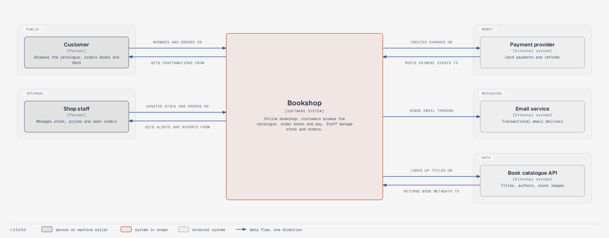
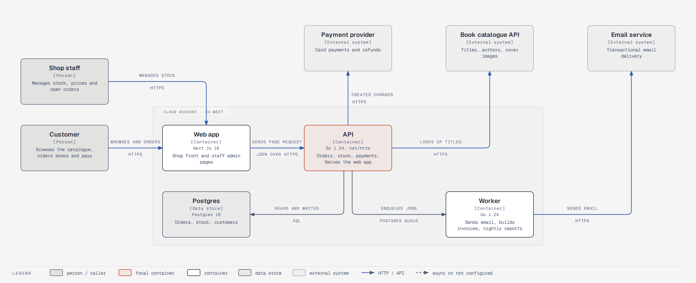
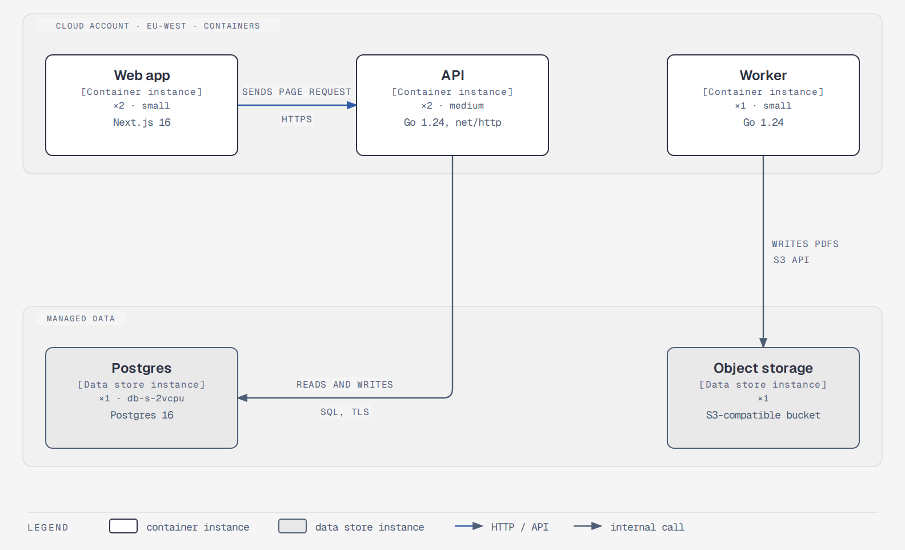

# c4-diagram

A Claude Code skill that draws [C4 model](https://c4model.com) diagrams of a software product from its code.

It helps a developer see the system they build: who uses it, what each user type sends in and gets out, which containers run, how they talk, and where they run.

## What it does

Two steps:

1. **Discover.** The agent reads the repos (deploy specs, Dockerfiles, CI workflows, config, routes, outbound clients, queues, schemas) and writes `c4-model.json`. Every element carries a `source` (`repo/path:line`). A guess is marked `"inferred": true`.
2. **Draw.** `scripts/render_c4.py` renders three diagrams from the model: System Context, Container and Deployment. Each diagram follows the C4 notation rules (name, type, technology, description on every element; one-direction verb-labelled arrows; title and legend). `scripts/c4_check.py` runs the C4 review checklist and flags overlaps.

Component and Code diagrams are out of scope on purpose. C4 says "the system context and container diagrams are sufficient for most software development teams."

## Example

`examples/bookshop/` holds a small model and its renders.







## Install

Copy this folder to your skills directory:

```bash
git clone https://github.com/STBlackHawk/c4-diagram-skill ~/.claude/skills/c4-diagram
```

Claude Code lists it as `c4-diagram`. Ask for "a C4 diagram of this repo" or "what goes in and out of this system".

## Render by hand

```bash
cd examples/bookshop
python3 ../../scripts/render_c4.py c4-model.json --out diagrams
python3 ../../scripts/c4_check.py c4-model.json diagrams
python3 ../../scripts/self_check.py diagrams/c4-context.html
pip install playwright && playwright install chromium
python3 ../../scripts/export_png.py diagrams/c4-context.html diagrams/c4-context.png
```

The renderer has no dependencies beyond Python 3.10. PNG export needs Playwright.

## Model file

See `references/model-schema.md`. The short version:

- `people[]`: human roles and machine callers, each with `inputs`, `outputs`, `main_in` and `main_out`.
- `external_systems[]`: things you do not own, with `in_label` and `out_label`.
- `containers[]`: applications and data stores with `technology`, placed on a grid with `layout: {gx, gy}`.
- `relationships[]`: one direction each, a verb label, a technology for container-to-container lines.
- `deployment.environments[]`: nodes and container instances per environment.

The model is the editable middle step. Fix a wrong fact or a bad layout in the model, never in the HTML.

## Brand profile

Colours and fonts come from `profiles/<slug>.json`. `default.json` is the diagram-design skin. Add your own profile with the same keys and name it in a `.c4-diagram` marker (`profile: <slug>`) next to the model, or pass `--profile <slug>`.

## Rules the renderer keeps

- Orthogonal connectors only. An off-axis arrow is an elbow. `route: "vh"` flips the elbow when it would pass behind a box.
- Every arrow label sits on a paper mask with a gap from its line.
- At most two accent elements per diagram.
- The System Context diagram shows at most 8 people and 8 external systems, with at most 2 arrows per element. The full inputs and outputs go into `c4-tables.md`.

## Credits

The visual system follows the diagram-design Claude Code plugin skill. `scripts/self_check.py`, `export_png.py` and `export_svg.py` are copied from it under the MIT License. C4 is by Simon Brown, [c4model.com](https://c4model.com).

## License

MIT. See `LICENSE`.
